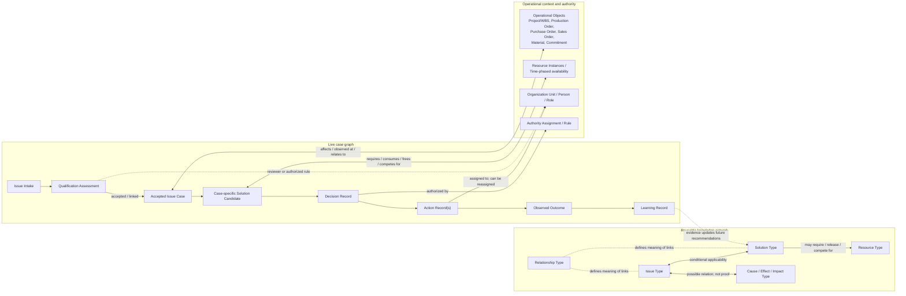
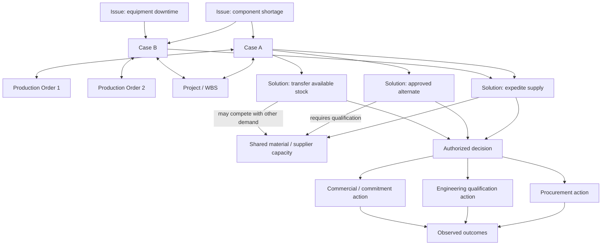

# Conceptual Master Data and Issue–Solution Network Map

**Status:** Conceptual baseline v0.3 — relationship topology and cardinalities proposed for MVP design.  
**Important boundary:** This is a model of the real-world relationship types the service must represent, not a claim that MANG_03 already contains live company records or verified causal links.

## 1. How to read the model

MANG_03 has three connected but distinct structures:

1. **Reusable knowledge network:** issue classes, candidate solution patterns, possible causes/effects, resource types, applicability conditions, and evidence.
2. **Live case graph:** actual issue intakes/cases, qualification assessments, operational objects, case-specific solution candidates, decisions, actions, and observed outcomes.
3. **Authority and responsibility graph:** people, roles, organizational units, scopes, and authority assignments that determine who may review, decide, escalate, or execute.

These structures connect, but must not be collapsed into one table or one fixed workflow. A reusable relationship is a hypothesis or rule for reuse; a case-specific relationship says why that relationship applies to this case, with evidence and confidence.

## 2. Network overview

The diagram shows the main entity families. Actual cases may skip, repeat, or branch between review, decision, action, and follow-up according to authority and context. The lifecycle arrows are not a universal three-level approval chain.

## 3. The network is not a single chain

A realistic example illustrates why the model must be many-to-many and contextual:

- One missing component may affect several production orders and projects.
- One production order may have several unrelated issues: missing material, equipment downtime, engineering clarification, or labor availability.
- One issue may have several candidate solutions: expedite a supplier, use an approved alternate, transfer stock subject to authorization, or negotiate a commitment change.
- A solution may help one order while consuming scarce material needed by another order. This is a shared-resource conflict, not automatically a causal relationship.
- One authorized decision can create multiple actions across procurement, engineering, production, project control, finance, or commercial teams.
- The actual result may differ from the expected impact; the outcome record must preserve that difference.

This is an illustrative topology, not a prescribed answer to the example. Whether an alternate is technically approved, whether a transfer is permitted, and whether a commitment is at risk must be verified for the actual case.

## 4. Entity catalogue and conceptual cardinalities

Cardinalities below describe the intended model, not finalized database foreign keys.

| Entity / relation | Cardinality | Why it exists |
|---|---|---|
| Issue Intake → Qualification Assessment | 1:N over time | Re-assessment is possible; keep every assessment and its rationale. |
| Accepted Issue Intake → Issue Case | 0..1 direct case link; many intakes may link to one case | Duplicates and reports about the same issue remain traceable without losing original submissions. A not-accepted intake has no formal case. |
| Issue Case ↔ Issue Type | M:N | A case may involve multiple issue classes; one class recurs across many cases. |
| Issue Type ↔ Solution Type | M:N through Issue–Solution Applicability | A solution may address multiple issue classes, but only under defined conditions. |
| Issue Type ↔ Issue Type | M:N through typed Issue Relationship | Captures subtype, related-to, possible cause/effect, or dependency without assuming causality. |
| Issue Case ↔ Issue Case | M:N through Case Relationship | Related, duplicate candidate, dependency, shared-resource conflict, or possible cascade; preserve direction and evidence. |
| Issue Case ↔ Operational Object | M:N through Case–Object Link | One case can touch many orders/projects/commitments; one object can have many cases. |
| Issue Case → Solution Candidate | 1:N | Case-specific assessment of each reusable solution pattern, including inapplicability and uncertainty. |
| Solution Candidate ↔ Resource Instance / Resource Window | M:N | Models required, consumed, released, transferred, or contested resources over a time window. |
| Solution Candidate ↔ Impact Assessment | 1:N | Separate expected effects by dimension, object, period, confidence, and assumptions. |
| Issue Case → Decision Record | 0:N | A case may have no decision yet, or have multiple decisions over time (e.g., revised decision). |
| Decision Record ↔ Solution Candidate | M:N through Decision–Option Link | Records selected combinations as well as rejected/retained alternatives and rationale. |
| Decision Record → Action Record | 1:N | A decision can produce several actions; action execution is tracked independently. |
| Action Record → Assignment History | 1:N | Ownership can change; keep the history rather than overwriting the prior owner. |
| Action Record → Outcome Record | 0:N | Partial, repeated, delayed, or unintended outcomes can be recorded. |
| Decision / Case → Outcome Record | 0:N | Enables comparison of expected versus actual results at case and decision level. |
| Outcome Record → Learning Record | 0:N | Not every outcome produces a generalized lesson; a lesson must cite supporting evidence. |
| Person ↔ Role ↔ Organization Unit | M:N via scoped assignment | A person can have multiple roles; a role may apply in different organizational scopes. |
| Role / Person / Scope ↔ Authority Rule | M:N via Authority Assignment | Authority can depend on function, site, case type, impact, risk, or value threshold. |
| Decision Profile → Profile Version | 1:N | Decisions retain the exact effective version and criteria used at decision time. |

## 5. Reusable master data versus live records

### Reusable master/configuration data

- **Issue Type:** stable identifier, name/description, parent or classification links, applicability scope, active/effective dates.
- **Solution Type:** stable identifier, description, prerequisites, exclusions, required approvals, and known implementation pattern.
- **Relationship Type:** controlled semantics such as `may_cause`, `may_affect`, `mitigates`, `requires`, `competes_for`, `alternative_to`, `duplicate_of`, `related_to`. Direction and causal strength must be explicit.
- **Issue–Solution Applicability:** conditions under which a solution pattern is relevant, required evidence, known risks, evidence strength, and validity.
- **Impact Type:** delivery, margin, cash flow/liquidity, customer commitment, quality, safety, compliance, capacity, or other configured dimension.
- **Resource Type:** material, equipment, manpower/skill, engineering capability, supplier capacity, money, or another constrained resource.
- **Decision Profile + Version:** goals, criteria, weights/thresholds, exclusions, and effective dates.
- **Qualification Rule + Version:** explicit acceptance, information-needed, duplicate/link, redirect, or non-acceptance criteria.
- **Operational Object Type / Source Mapping:** identifies external object class and how its key/source are resolved.
- **Organization, Role, Authority Rule:** reference structures or mapped identities from authoritative systems.
- **Outcome / Learning Category:** controlled labels, not a substitute for observed facts.

### Live transactional records

Issue Intake; Qualification Assessment; Issue Case; Case Relationship; Case–Object Link; Solution Candidate; Feasibility Assessment; Impact Assessment; Resource Requirement/Allocation Assessment; Decision Record; Decision–Option Link; Action Record; Action Assignment History; Outcome Record; Learning Record; Audit Event.

Do not store changing case estimates, current stock availability, a decision outcome, or a specific person assignment inside a reusable master definition.

## 6. Relationship record: minimum semantics

Each explicit relationship should support, as appropriate:

- stable relationship ID and relationship type;
- source entity/ID and target entity/ID;
- direction and clear semantics;
- scope/context and applicability conditions;
- valid-from / valid-to and version;
- strength/weight only where meaningful (do not invent numeric weights for every edge);
- confidence, evidence references, provenance/source, and reviewer;
- epistemic status: observed fact, externally sourced fact, assumption, hypothesis, or inferred link;
- effective state: proposed, under review, accepted for use, rejected, expired;
- created/changed by and timestamps.

For causal or impact edges, also record whether the link is merely possible, supported by evidence, or validated for the current case. A general relationship between two issue types must not be copied into a live case as a proven cause without case-specific evidence.

## 7. How a live case uses the reusable network

1. Capture the Intake and evidence. Do not require the submitter to diagnose root cause or know the full value-chain impact.
2. Run the Qualification Gate; record criteria, evidence, decision, actor/rule version, and rationale.
3. On acceptance, create or link the Issue Case. Check for duplicates but preserve each intake.
4. Link the case to known operational objects and issue types. Mark uncertain links as proposed rather than facts.
5. Retrieve applicable Solution Types using the case's context and explicit applicability rules. Generate case-specific Solution Candidates only after qualification.
6. Assess each candidate's feasibility, impacts, resource conflicts, timing, confidence, and evidence separately from priority.
7. Route review/decision using scoped authority; manager may decide within authority or escalate.
8. Record decision, selected and rejected alternatives, profile version, and rationale.
9. Create actions and assign owners based on the decision; preserve reassignment history.
10. Record actual execution and outcomes. Only then create evidence-backed learning that may affect future applicability or ranking.

## 8. Network integrity rules

- Never treat association as causality.
- Never infer a delivery delay or financial loss solely from a component or equipment issue.
- Do not add an impact merely because a generic issue-type relationship exists; check current operational context and evidence.
- Do not equate feasibility with priority, or a weighted rank with authority to decide.
- Do not equate decision, action completion, and issue resolution.
- Do not train recommendations on the fact that an option was selected alone.
- Preserve rejected/redirected intake, merge links, prior relationship versions, prior decisions, and reassigned action owners.
- Keep estimates and assumptions separate from observed outcomes.
- Do not recreate ERP production plans; link to the existing order, project, material, and commitment records and record authorized decisions/actions around them.

## 9. MVP implementation boundary

For the first MVP, implement the model as a **small, explicit set of entity types and typed relationship records**, not as an open-ended graph platform. Keep identifiers and source mappings stable, and use a relational persistence model if that is simpler. The conceptual graph describes semantics; it does not mandate graph-database technology.

Suggested MVP core: Issue Intake, Qualification Assessment, Issue Case, Issue Type, Solution Type, Issue–Solution Applicability, Case–Object Link, Solution Candidate, Decision Profile Version, Decision Record, Action Record, Outcome Record, plus Audit Event. Add richer resource time-phasing, causal inference, and learning sophistication only as validated scenarios require them.

## 10. Decisions still open

- Final standard Issue Type and Solution Type catalogue.
- Whether Issue Type taxonomy permits multiple parents.
- Which relationship types can be auto-proposed and which require human validation.
- Exact confidence/weight representation and minimum evidence requirements.
- Time-phased resource representation required in the MVP.
- Authoritative source and key mapping for each operational object.
- Exact authority thresholds and escalation rules.
- Whether the MVP stores graph traversals as queries over relational tables or needs a specialized graph store. No specialized graph database is assumed by this conceptual model.

## 11. Financial impact and profile-based choice

Every case-specific Solution Candidate should have its own Financial Impact Assessment before final selection where sufficient data exists. Do not attach a single fixed financial score to the reusable Solution Type. Assess, where supported, direct implementation cost, margin/profit effect, cash-flow amount and timing, avoided cost/loss, opportunity cost of shared resources, and evidenced delay/commitment costs. Keep net financial impact, margin/profitability, and cash-flow/liquidity distinct. Store currency, baseline, time horizon, method/formula, input sources, assumptions, uncertainty range, confidence, and calculation/model version. Do not double-count overlapping impacts or present unsupported precision.

Decision Profiles are configurable and versioned. Parameters may include sales/customer commitments, liquidity preservation, margin, delivery, quality, safety, compliance, and resource priorities. Record the active profile version and parameter values with each decision. Evaluate feasibility separately from profile-based ranking; hard legal, safety, technical, resource, and authority constraints must have explicit reasons.

## 12. Decisions at different authority levels

A lower-level selection does not hide or disable other applicable solution candidates for higher-level managers. Candidate visibility and evaluation are separate from the current effective decision. A higher-level authorized manager may select another solution within applicable hard constraints. Preserve the earlier decision and record the later decision as new or superseding, with rationale and links to affected decisions. Assess actions already started and explicitly record authorized continuation, amendment, cancellation, or replacement. Never silently overwrite prior decisions or actions.

## 11. Financial impact and profile-based choice

Each case-specific Solution Candidate should have its own Financial Impact Assessment before final selection where data permits. Do not attach one fixed financial score to the reusable Solution Type. Assess direct implementation cost, margin/profit effect, cash-flow amount and timing, avoided cost/loss, shared-resource opportunity cost, and evidenced delay/commitment costs as separate components. Keep net financial impact, profitability/margin, and cash flow/liquidity distinct. Record currency, baseline, time horizon, method, source inputs, assumptions, uncertainty range, confidence, and calculation version. Avoid double-counting and unsupported precision.

Decision Profiles are configurable and versioned. Parameters may include sales/customer commitments, liquidity preservation, margin, delivery, quality, safety, compliance, and resource priorities. Record the active profile version and parameter values with each decision. Evaluate feasibility separately from profile ranking; hard legal, safety, technical, resource, and authority constraints must have explicit reasons.

## 12. Decisions at different authority levels

A lower-level selection must not hide or disable other applicable solution candidates for higher-level managers. Candidate visibility is separate from the current effective decision. A higher-level authorized manager may select another solution within applicable constraints. Preserve the earlier decision and record the later decision as new or superseding, with rationale and links to affected decisions. Assess actions already started and explicitly record authorized continuation, amendment, cancellation, or replacement. Never silently overwrite prior decisions or actions.
