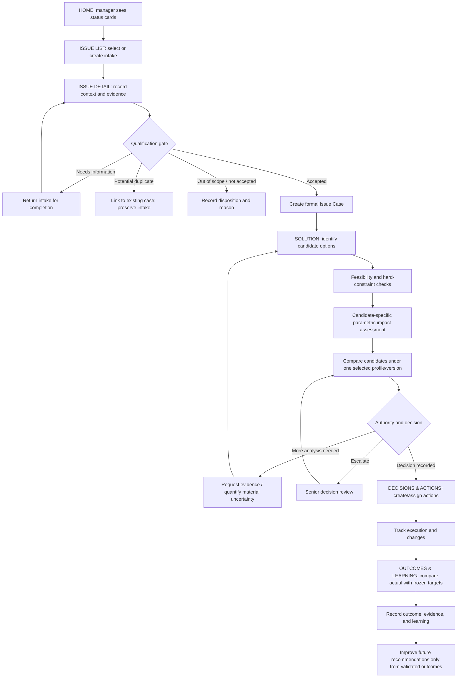

# MVP End-to-End Chain — ISSUE → SOLUTION → DECISION → ACTION → OUTCOME

**Document ID:** MANG03-DESIGN-CHAIN-001  
**Status:** MVP / demo design baseline; scenario data are illustrative, not company facts.  
**Version:** 1.0 — 2026-10-28  
**Purpose:** Model one traceable, realistic user journey from initial Issue submission through Solution assessment, decision, execution, observed outcome, and learning. This document defines the business chain and screen transitions; it does not claim live ERP integration or production-ready implementation.

## 1. Product and navigation decisions incorporated

The MVP uses one consistent HOME layout for all users; the data and available actions may vary by role/context. The demo does not require separate navigation trees by role.

Primary sidebar:
1. HOME
2. ISSUE — submit, review, qualify, and inspect issues
3. SOLUTION — assess and compare solution candidates for a specific accepted Issue
4. PROJECTS & PORTFOLIO — project/value/risk and product/business-area views
5. DECISIONS & ACTIONS — recorded decisions and execution tracking
6. OUTCOMES & LEARNING — actual outcome review and evidence-based learning
7. REPORTS & ANALYTICS
8. SETTINGS — language/theme/personal preferences, parameter catalogue and scales, formulas/thresholds, decision profiles, workflow rules, notifications, and data-source settings

For this MVP/demo, the sidebar is not separated into role-specific variants. Sensitive or organization-wide settings may be represented in the demo, but production authorization and approval controls remain necessary design requirements.

## 2. One illustrative business scenario

**Scenario:** A manufacturing project reports uncertainty about the availability date of a critical component.

The initial report is not proof that a delivery commitment will be missed, nor proof of financial loss. Those are possible impacts to investigate and validate.

- Initial Intake: `INT-118`
- Accepted Issue Case: `CASE-024`
- Linked project: `PROJECT-T-07` (illustrative)
- Issue title: “Critical component availability date is unconfirmed”
- Reporter: Project supply coordinator (illustrative role)
- Evidence: supplier confirmation is pending; latest confirmed date and alternatives are recorded as unknown until verified.
- Business question: “Which response should management authorize, given delivery, liquidity, margin, resource, and execution constraints?”

The scenario must keep facts, assumptions, hypotheses, estimates, and observed outcomes visibly distinct.

## 3. End-to-end chain

This is a reference path, not a mandatory route for every case. Supported cases may enter at a justified point, skip irrelevant steps, or escalate directly according to configured rules and authority. The qualification disposition must remain traceable even when the formal Issue Case is not created.

## 4. Stage-by-stage behavior and screen contract

### Stage 0 — HOME

**Purpose:** Give the manager an immediate operational summary and a path into work.

- Top section: status cards for incoming/unreviewed Issues, information needed, decision pending, actions in progress, and urgent attention.
- A card click opens ISSUE LIST with the corresponding filter applied.
- “Urgent attention” is a cross-cutting alert view, not necessarily a mutually exclusive lifecycle state. A case may simultaneously be in action and require urgent attention.
- Middle section: project value/risk map and product/business-area portfolio status.
- Lower section: decisions, projects requiring attention, and important recent changes.
- All counts and lists must be consistent with the underlying records and the user's current scope. In the demo, label synthetic values as demo data.

### Stage 1 — ISSUE LIST and initial intake

**Purpose:** Find, review, and create incoming issues.

Minimum list columns:
- Intake/Case ID and title
- Intake or lifecycle status
- Related project/business object, if known
- Reporter and current owner
- Submitted/updated time
- Attention/urgency marker with reason
- Next expected action

Actions:
- Create Issue
- Open Issue Detail
- Filter/search/sort
- Resume a returned intake
- Open a linked duplicate/existing case

Do not silently merge or discard an intake. Preserve its own history and its relationship to the linked case.

### Stage 2 — ISSUE DETAIL and qualification

Initial Intake and formal Issue Case are separate concepts. Intake captures what was reported; qualification decides whether and how it enters the formal Issue–Solution cycle.

Minimum information:
- Problem statement and observed facts
- Context, time horizon, affected scope, and operational object links
- Evidence/source, timestamp, owner, and confidence where applicable
- Known impact versus possible impact
- Missing information and assumptions
- Qualification result, rationale, reviewer, and timestamp

Qualification outcomes:
1. Accepted — create/link a formal Issue Case.
2. Needs information — return with explicit questions and preserve intake.
3. Potential duplicate — link to an existing case; do not delete the intake.
4. Out of scope / redirect — record reason and destination where applicable.
5. Not accepted — record an explainable reason and retain the full audit trail.

First-stage Solution suggestions should not be presented as formally actionable candidates until the Issue passes the qualification gate. A user may still see clearly labelled generic guidance if the product later supports it, but it must not be confused with case-qualified candidates.

### Stage 3 — SOLUTION workspace

**Purpose:** Assess and compare possible responses to one accepted Issue. This is separate from ISSUE management in the sidebar but remains linked to the Issue Case.

Example candidate set (illustrative only):
- S1 — Expedite the existing supplier order.
- S2 — Qualify an alternate source or substitute component.
- S3 — Re-sequence work to use available capacity while awaiting confirmation.
- S4 — Escalate for a negotiated commercial or delivery commitment.

These are hypotheses to assess, not recommendations or claims that the options are feasible.

Each candidate must show:
- Candidate description, owner, status, assumptions, and supporting evidence
- Applicability/context and link to the parent Issue Case
- Feasibility assessment, with blockers and hard constraints
- Candidate-specific impact assessment
- Resource requirements, timing, dependencies, and uncertainty
- Comparison profile/version used in the current comparison
- Open questions and next action

A candidate can be infeasible, feasible with conditions, unknown, or awaiting evidence. Feasibility must not be blended into a weighted preference score.

### Stage 4 — Candidate assessment and comparison

For the demo, managers can enter a transparent 1–5 initial assessment on a governed parameter catalogue. Example dimensions include:
- Delivery commitment protection (higher is better)
- Financial resources required (higher is worse)
- Margin protection (higher is better)
- Liquidity pressure (higher is worse)
- Scarce/shared resource consumption (higher is worse)
- Execution risk (higher is worse)

These are illustrative dimensions; the final parameter catalogue and scale anchors remain configurable/open. For every rating, show the meaning of the score, direction, rationale, assessor, time, and evidence. `Unknown / Not assessed` is not zero and not neutral.

Rules:
- Use the same selected comparison profile and version for all candidates in one comparison.
- A candidate-specific profile perspective may be shown separately; it must not secretly change the weights used to compare competing candidates.
- Normalize preference direction before calculating any weighted index.
- A weighted index is a transparent prioritization aid, never money or an objective probability of success.
- Missing data and coverage must remain visible. The demo must not manufacture a precise ranking when a material dimension is unknown.
- Keep financial resources required separate from net financial impact, profit/margin, and cash-flow timing.
- Hard constraints (legal, safety, technical, timing, resource, and authority) cannot be overridden by a high aggregate score.
- Quantified financial analysis may be requested when the impact is material and sufficient evidence is available; it is not mandatory for every initial assessment.

### Stage 5 — Decision record

A decision records what an authorized decision-maker chose, why, under which context/profile, and with what targets or constraints.

Minimum fields:
- Decision ID, parent Issue Case, selected candidate(s), and decision status
- Decision-maker and authority basis
- Decision rationale and alternatives considered
- Profile ID/version, parameter values/weights, and score explanation used at decision time
- Frozen target/threshold for each relevant parameter
- Hard constraints and any exceptions/escalation approvals
- Assumptions, evidence, confidence, and unresolved uncertainty
- Effective date, review point, and superseded decision links if applicable

The selected candidate is not automatically a successful solution. A lower-level decision does not erase other applicable candidates from higher-level review. If a later decision supersedes an earlier one, preserve both and assess actions already started.

### Stage 6 — DECISIONS & ACTIONS

The decision and its execution are separate records. A decision can create one or more actions, assigned to owners who may differ from the Issue reporter, candidate proposer, or decision-maker.

Minimum action fields:
- Action ID and linked decision/candidate/case
- Action description and expected evidence of completion
- Responsible owner and assignment history
- Due date, status, dependency, and escalation condition
- Actual start/completion timestamps and execution evidence
- Change/cancellation/amendment reason if the decision changes

Possible action states may include Planned, Assigned, In Progress, Blocked, Completed, Cancelled, and Superseded. Final state names are configurable; transitions and audit history must be explicit.

### Stage 7 — OUTCOMES & LEARNING

Outcome review compares observed results with the targets frozen when the decision was made.

Minimum outcome record:
- Linked decision, candidate, case, and action set
- Review date, evaluator, evidence/source, and outcome coverage
- Observed value/rating for each relevant parameter, or explicit Unknown
- Original frozen target/threshold and whether it was met
- Hard-constraint breaches, kept visible regardless of aggregate score
- Overall outcome: Successful / Partially successful / Unsuccessful / Unknown, with rationale
- Unintended effects, residual issue, and lessons learned
- Whether the result is eligible for learning and why

Example: if the original liquidity target was at least 2/5 and the observed result is 1/5, record a target breach. Meeting the liquidity target alone does not prove overall success. Do not rewrite the original target after execution.

Only evidence-backed observed outcomes may contribute to future Best Profile or solution recommendations. Show sample size, context, outcome coverage, and uncertainty; do not infer causality from correlation or infer success from the chosen option alone.

## 5. Core record links

The minimum traceable chain is:

`IssueIntake → QualificationAssessment → IssueCase → SolutionCandidate(s) → FeasibilityAssessment + ImpactAssessment → DecisionRecord → ActionRecord(s) → OutcomeRecord → LearningRecord`

Supporting links:
- Issue Case ↔ operational objects (project, component/material, purchase order, commitment, etc.)
- Issue Case ↔ case-specific relationship/evidence records
- Solution Candidate ↔ reusable Solution Type / applicability knowledge
- Decision Record ↔ profile/version and frozen decision-time targets
- Action Record ↔ assignment history and execution evidence
- Outcome Record ↔ actual observations, targets, and evidence

A reusable knowledge relationship is not proof of a case-specific relationship. A case-to-object link is not proof of causation. A recorded estimate is not an observed outcome.

## 6. Status model: do not overload one status field

Use separate, related status dimensions rather than one giant enum:
- Intake/qualification status
- Formal Issue Case status
- Candidate assessment/feasibility status
- Decision status
- Action execution status
- Outcome review status
- Cross-cutting attention flags (urgent, overdue, hard-constraint risk, missing evidence)

This enables a case to have an accepted Issue, several candidate solutions, one recorded decision, multiple actions at different execution states, and an outcome review that is still pending.

## 7. Audit and data integrity requirements

Every material change must preserve actor, timestamp, previous/new value or version, reason where relevant, source, and links to affected records.

Cross-screen integrity checks:
- HOME counts must reconcile with ISSUE LIST filters.
- A Solution workspace opened from an Issue must use that exact Issue Case ID.
- Every candidate shown in a comparison must belong to the same Issue Case unless an explicitly supported cross-case comparison is designed later.
- The active comparison profile/version must be identical across candidates in that comparison.
- A decision must reference the exact candidate(s) considered and the profile/version/targets used.
- Each action must link to its originating decision and relevant case/candidate.
- Outcome review must read frozen decision-time targets, not current mutable settings.
- A superseding decision must not silently erase earlier decisions or action history.
- Unknown, missing, stale, and contradictory data must be visible and handled explicitly.
- Demo data must be labelled and must never be presented as live operational data.

## 8. MVP acceptance walkthrough

A demo is considered to demonstrate the chain when a user can:

1. See an incoming Issue count on HOME and open a filtered ISSUE LIST.
2. Create/open an intake and inspect its detail and evidence.
3. Return an intake for missing information and later resume it without losing history.
4. Accept an intake and create a formal Issue Case, or record another transparent disposition.
5. Open SOLUTION from that exact Issue and create multiple candidate options.
6. Record feasibility blockers and candidate-specific impact ratings, including Unknown.
7. Compare candidates using one shared profile/version, with hard constraints separate from weighted priority.
8. Record an authorized decision with rationale and frozen targets.
9. Create/assign multiple actions, update execution states, and preserve reassignment history.
10. Record observed outcome evidence and compare it against original targets.
11. Mark the overall outcome separately from individual parameter target attainment.
12. Show how the validated outcome may inform learning without automatically changing an approved profile.
13. Navigate between HOME, ISSUE, SOLUTION, DECISIONS & ACTIONS, and OUTCOMES & LEARNING without record-ID or status contradictions.

## 9. Explicitly not implied by this model

- No live ERP data or connection is assumed.
- No causal effect or financial loss is inferred solely from the example component uncertainty.
- No candidate is asserted feasible until evidence/constraints support that conclusion.
- No automated production schedule changes are allowed.
- No weighted score is a financial amount or probability of success.
- No decision selection alone qualifies as successful outcome evidence.
- Production-grade role/permission enforcement, integration security, and deployment readiness are not claimed by this design document.

## 10. MVP catalogue-authoring button behavior

The ISSUE and SOLUTION screens must retain the **NEW ISSUE** and **NEW SOLUTION** buttons in the related reusable Issue Type / Solution Type selection forms. In the MVP, both buttons are visibly disabled (not hidden), have a tooltip/helper message such as “Available in a future version,” and trigger no click, keyboard, modal, navigation, API, or data-write behavior. This applies only to reusable catalogue definitions. It must not disable the normal **Create Issue Intake** flow or the ability to add a case-specific **Solution Candidate** to an accepted Issue.

Acceptance checks:
- Both buttons are visible in their related forms and use a real disabled state, not just muted styling.
- Keyboard focus/activation and pointer interaction cannot invoke them.
- No catalogue record or draft is created and no backend request is sent.
- The form still supports selecting existing catalogue entries and all other enabled MVP actions.
- UI labels/tooltips make the future-version limitation clear without suggesting that the entire Issue/Solution workflow is unavailable.

## 11. Next modeling sequence

1. Validate this chain and the scenario-specific user journeys.
2. Design the HOME and sidebar visual prototype, then ISSUE LIST/DETAIL.
3. Design SOLUTION workspace and candidate comparison.
4. Design Decision Record and Actions.
5. Design Outcome Review.
6. Reconcile screen fields against the conceptual data model and acceptance checks.
7. Only then finalize API contracts, physical schema, and implementation tasks.
