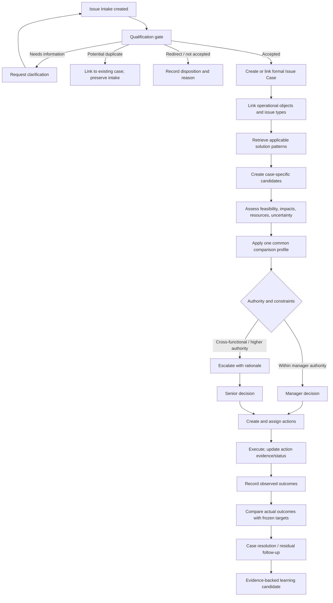

# Reference Design Scenario — End-to-End Issue-to-Outcome

**Document ID:** MANG03-DESIGN-REF-001  
**Status:** Architecture design baseline for MVP; scenario values are illustrative, not company facts.  
**Version:** 1.0 — 2026-10-28  
**Purpose:** Provide one complete, traceable scenario from initial issue intake through qualification, candidate assessment, profile-based decision, actions, observed outcomes, and learning. Use it to validate screens, conceptual data, state transitions, permissions, auditability, and later API/database design.

## 1. Design rules

1. MANG_03 is an enterprise Issue–Solution decision-support service. It does not replace ERP, project controls, production execution, or detailed production planning and does not autonomously reschedule production.
2. The scenario is a validation path, not a mandatory linear workflow. A manager may decide within delegated authority or escalate directly when rules/context require it.
3. Keep three connected structures distinct: reusable knowledge network, live case graph, and organization/authority graph.
4. Keep Issue Intake separate from accepted Issue Case. Preserve every intake and every qualification disposition.
5. A generic relationship suggests what may apply; it does not prove a case-specific relationship or causality.
6. Keep feasibility, priority, decision, action, resolution, expected impact, and observed outcome distinct.
7. Each candidate is assessed for the current case. Never copy a universal impact score from a reusable Solution Type.
8. Record the profile version, its goals/weights, and the target thresholds used at decision time. Later results are compared with this frozen baseline; do not rewrite it retrospectively.
9. Unknown is not zero, neutral, or success. Show missing data and its effect on comparison.
10. A weighted profile index is a transparent priority aid, not money, objective truth, or probability of success. Hard constraints cannot be compensated for by a high weighted score.
11. Keep the MVP simple and explainable. Final scale anchors, authority thresholds, integration mappings, and detailed scoring rules can be refined through validation without blocking the initial UI/data design.

## 2. Reference scenario

A project team reports that a component needed for a production order may not arrive by the required date. This is a potential risk, not yet proof that a contractual delivery will be missed or that a financial loss will occur.

Illustrative context:
- Affected operational objects may include a project/WBS, production order, material/component, purchase order, supplier commitment, and customer/project milestone.
- Possible response patterns include expediting supply, using an alternate component if technically approved, transferring available stock if authorized and not harmful to a higher-priority demand, or negotiating a commitment change.
- The decision context selects **Liquidity Protection** as the comparison profile for this decision. The exact profile and parameter targets are recorded with the decision. This is not a claim that liquidity always outranks delivery or safety.
- Illustrative liquidity target: score **at least 2/5** on the agreed scale. The actual anchor text must be visible to the user. If the observed outcome is 1/5, the liquidity target is breached. A score of 2/5 or higher means only that this particular target was met; it does not prove the whole decision succeeded.
- No real amounts, lead times, inventory balances, or causal claims are assumed in this document.

## 3. End-to-end lifecycle

Branches can repeat. New evidence may reopen assessment, add candidates, supersede a decision, or trigger further actions. No prior record is silently overwritten.

## 4. Actors, responsibilities, and permissions

Actual permissions must be configured against the organization's authority model; role names below are conceptual.

| Actor / role | Responsibilities | Must not be assumed |
|---|---|---|
| Submitter / observer | Describe what was observed, when/where, affected objects if known, urgency, evidence, and uncertainty; answer clarification requests | Does not need to identify root cause, calculate financial impact, or propose a complete solution |
| Qualification reviewer / authorized rule | Check completeness, scope, possible duplicate, and routing; record disposition and rationale | Must not silently discard an intake due to an opaque score |
| Subject-matter expert | Validate technical/operational facts, constraints, estimates, and evidence | Is not automatically the owner of enterprise-level impact or decision |
| Responsible manager | Own initial case-specific candidate assessment, compare options, decide within delegated authority or escalate | Cannot bypass hard constraints or alter the historical profile baseline after the decision |
| Cross-functional reviewers | Validate relevant procurement, engineering, production, project, finance, quality/safety/compliance facts | Review input does not itself constitute a decision unless authority permits it |
| Senior decision forum / CEO delegate | Decide enterprise trade-offs requiring broader authority; approve exceptions within delegated rules | Is not restricted to cash allocation and does not automatically own all actions |
| Action owner | Execute assigned work, report progress, evidence, blockers, and actual results | Is not necessarily the issue submitter or decision-maker |
| Profile/configuration steward | Maintain parameter catalogue, profile versions, and approved defaults within granted authority | Cannot silently rewrite versions already used by decisions |
| Auditor / read-only reviewer | Inspect records, decisions, evidence, history, and authorization basis | Cannot change records without separately granted permissions |

Every write operation must check both role and scope (for example, site, project, function, case type, risk, or value threshold). Being a manager alone is not sufficient proof of authority for every case.

## 5. Screens and user journeys

The first UI design should be based on these screen responsibilities. The layout is not yet a commitment to specific colors or visual styling.

### 5.1 Work Queue / Home

Purpose: help each user see what requires their attention now, without making the Home screen a second ERP.

Show:
- assigned-to-me items, pending qualification, requests for information, decisions awaiting my authority, overdue/blocked actions, and cases awaiting outcome review;
- critical risk/constraint indicators and the reason behind each;
- case ID, short title, affected object summary, current owner, current state, age/next due date, and latest meaningful update;
- filters for role/scope, urgency, status, issue type, affected project/site, and date;
- counts that drill into the exact same filtered records as the detail list.

Rules:
- Do not display a single “health score” without its definition and supporting facts.
- Do not infer delay, financial loss, or causality solely from an issue type.
- Home cards and detail pages must use the same source record IDs, filter definitions, status semantics, and calculation timestamps.
- Empty states explain what the user can do next; access-restricted records are not exposed by aggregate counts if that would leak sensitive information.

### 5.2 Create / View Issue Intake

Required minimum fields:
- generated Intake ID (read-only);
- short title (required);
- observed problem description (required; factual language encouraged);
- observed-at date/time and reported-at timestamp (reported-at system-generated);
- location/site/department/process where known;
- submitter identity and organization scope (system-derived where possible);
- affected operational object type and external key(s), if known;
- immediate safety, quality, compliance, customer, delivery, or operational risk flags where relevant;
- evidence attachments/links and source;
- suspected cause or suggested response (optional and explicitly marked as a hypothesis/suggestion);
- urgency and reason;
- confidentiality/access classification;
- duplicate/related case suggestion (optional).

Validation:
- identify missing essential details but allow saving a draft when policy permits;
- distinguish “not known” from “not applicable”;
- preserve submitted text and submitted attachments as an immutable historical version;
- show submission receipt and current qualification status;
- never require a monetary impact estimate at intake.

### 5.3 Qualification Workbench

Show the original intake alongside:
- completeness checks and missing information;
- in-scope/out-of-scope criteria and applicable rule version;
- possible duplicate/related cases with comparison basis;
- issue-type suggestions and confidence/evidence, clearly labelled as suggestions;
- reviewer, timestamp, disposition, rationale, and next owner.

Allowed outcomes:
- **Accepted:** create/link formal Issue Case and continue.
- **Needs information:** ask for specific fields/evidence; preserve intake and prior assessments.
- **Potential duplicate / linked:** link to existing case without deleting the new intake; authorized reviewers can confirm or reverse the link.
- **Out of scope / redirected:** record destination/process and reason where known.
- **Not accepted with reason:** record explicit criterion, rationale, actor/rule version, and required review.

No first-stage solution candidate list should be presented as applicable recommendations until the case passes the qualification gate. A reviewer may record a known potential solution as intake context, but it is not yet a qualified recommendation.

### 5.4 Issue Case workspace

After acceptance, show:
- case ID, summary, severity/urgency rationale, current status, owner, and next expected action;
- linked intakes and duplicate/related-case relationships;
- issue types and whether they are confirmed or provisional;
- operational-object links with source system, external key, relation meaning, validation state, and last sync time if applicable;
- known facts, assumptions, hypotheses, and unresolved questions separately;
- relevant solution patterns and applicability conditions;
- timeline of qualification, reviews, decisions, actions, outcomes, and changes;
- current risks, dependencies, resource conflicts, and follow-up.

Users must be able to distinguish the reusable pattern (“this solution may apply to this issue type”) from the case-specific finding (“this option applies to this case because evidence X was reviewed”).

### 5.5 Candidate Assessment & Comparison

Create one **Solution Candidate** record for each case-specific option. Show candidates side-by-side using the same comparison profile and same scale version.

For each candidate display:
- proposed response and linked reusable Solution Type/version;
- applicability status, prerequisites, exclusions, and evidence;
- feasibility: feasible / conditionally feasible / infeasible / unknown, with reasons and reviewer;
- required actions, resources, timing windows, dependencies, and affected operational objects;
- impact ratings by parameter, direction, anchor text, rationale, confidence, and evidence;
- explicitly unknown/not-assessed dimensions;
- any quantified amount/range only when supported, with currency, period, source, assumptions, method/version, and uncertainty;
- hard constraints and whether each is satisfied, violated, or unresolved;
- selected comparison profile/version and its weights/targets;
- weighted priority indicator only if required inputs and the configured rule permit it, with visible explanation and coverage;
- revision history and assessor.

Rules:
- A hard constraint failure cannot be offset by a high profile score.
- The same selected comparison profile and scale version apply to every candidate in one comparison.
- A candidate-specific profile can be viewed as an additional scenario, not used to produce an unfair cross-candidate rank.
- Missing required data must be visible; do not silently impute a neutral value.
- Keep priority and feasibility separate. “Top ranked” does not mean “authorized” or “ready to execute.”

### 5.6 Decision Record / Decision Room

Before confirmation, show:
- selected option(s) and all alternatives considered;
- feasibility and hard-constraint status;
- expected effects by parameter, resource, object, and period;
- selected Decision Profile name/version, parameter values, weights, target thresholds, and scoring-rule version;
- decision-maker, delegated authority basis, date/time, rationale, assumptions, accepted risks, and exceptions;
- dissenting/review comments where applicable;
- the target/acceptance conditions that will later be used to assess the outcome;
- generated action proposal and affected existing actions, if superseding a prior decision.

Decision states should be distinct from case and action states, for example: draft, under review, approved/recorded, rejected, superseded, cancelled (only where allowed). Final enum names require validation during detailed workflow design.

A recorded decision is immutable as a historical event. A later change creates a new or explicitly superseding decision linked to the previous one. The current effective decision is a derived view, not a reason to delete history.

### 5.7 Action Board

Each action includes:
- Action ID, linked decision/case, concise verb-led description, accountable owner, responsible organization, due date, priority, dependencies, and expected evidence of completion;
- status, progress note, blockers, attachments/evidence, last update, and next review date if needed;
- assignment history, reassignment reason, previous and new owner;
- source/target operational object links where relevant;
- authorization record for cancellation, amendment, or replacement.

One decision may generate multiple actions across functions. An action owner may differ from the submitter, manager, and decision-maker. A new decision must explicitly address in-progress actions: continue, amend, cancel, or replace through an authorized transition.

Action completion is not automatically case resolution. A completed action may have failed to achieve its intended outcome.

### 5.8 Outcome Review

Capture actual results separately from expected impact:
- action execution evidence and completion dates;
- actual observed values by parameter, unit/scale, time period, source, and timestamp;
- realized cost/cash-flow/margin/delivery/resource/quality results where available;
- actual value for the same qualitative 1–5 dimensions when a defensible assessment is possible;
- whether each target/threshold recorded at decision time was met, breached, or remains unknown;
- unexpected positive/negative effects and residual risks;
- issue resolution state: resolved, partially resolved, unresolved, or follow-up required;
- assessor, evidence, confidence, and review date.

Outcome review must compare against the frozen decision-time target and profile version. It must not change the original target to make the decision look successful. If evidence is insufficient, use **Unknown / Not assessed**, not automatic failure or success.

### 5.9 Learning & Best Profile

Show:
- the profile/version and context;
- number of comparable decisions and sample size;
- outcome coverage (known vs missing outcomes);
- successful/partially successful/unsuccessful/unknown cases under the agreed outcome rule;
- parameter-level target attainment and any hard-constraint breaches;
- period, case types, execution evidence, and comparability limitations;
- uncertainty and warnings for small samples or inconsistent outcome definitions;
- whether the profile is only a system-suggested candidate or an approved organizational profile.

Best Profile is context-dependent where appropriate. The system must not declare a universal winner from raw selection frequency or small, incomparable samples. Recommendation is not automatic profile adoption.

## 6. Data model: records and required attributes

The following is the conceptual data contract for the reference scenario. It is not yet a physical SQL schema; data types, indexes, and API shapes follow after validation.

### 6.1 Common fields and audit envelope

For each material record, as applicable:
- internal stable ID;
- record type and schema/version;
- organization/tenant and security scope;
- created by / created at;
- last changed by / changed at;
- lifecycle status and effective date range;
- source system and external key where integrated;
- record version / optimistic concurrency token;
- sensitivity classification;
- audit correlation/event ID;
- soft-deletion or archival policy where allowed (never hard-delete history that is required for audit).

Store times in a consistent technical standard (for example UTC) and render in the user's configured timezone. Preserve source timestamps and timezone where received. Define units/currencies explicitly rather than relying on labels alone.

### 6.2 Core entities

| Entity | Minimum required attributes | Important links / rules |
|---|---|---|
| Issue Intake | intake_id, title, description, observed_at (if known), reported_at, submitter_id, org_scope, urgency, disposition_status, confidentiality, evidence refs | May link to one formal case; many intakes may be linked to one case; preserve each intake |
| Qualification Assessment | assessment_id, intake_id, rule_version, criteria results, missing info, disposition, rationale, reviewer/rule actor, timestamp | One intake can have multiple historical assessments |
| Issue Case | case_id, summary, current lifecycle view, owner, severity/rationale, accepted_at, classification version | Only created/linked after acceptance; current status is a projection of events/state |
| Issue Type | issue_type_id, name, description, hierarchy, effective dates, status | Reusable master; version or effective-date strategy required |
| Solution Type | solution_type_id, name, description, prerequisites, exclusions, required approvals, known risks, status/version | Reusable response pattern, not a case decision |
| Applicability Rule | applicability_id, issue_type_id, solution_type_id, conditions, exclusions, evidence requirements, confidence, version/status | Conditional many-to-many link; does not prove applicability to a live case |
| Case–Object Link | link_id, case_id, object_type, source_system, external_key, relation_type, evidence, validation_status, valid time | Many-to-many; never assume the object is affected just because it was mentioned |
| Relationship Record | relationship_id, source/target IDs, relation_type, direction, scope, conditions, epistemic status, evidence, confidence, validity/version, reviewer | Association is not causation; semantics must be explicit |
| Solution Candidate | candidate_id, case_id, solution_type/version, description, applicability status, candidate status, proposed_by, rationale | Case-specific option; one case may have many candidates |
| Feasibility Assessment | feasibility_id, candidate_id, status, constraints, reasons, assessor, evidence, confidence, timestamp | Separate from profile score; may be reassessed |
| Impact Assessment | impact_assessment_id, candidate_id, parameter_id/version, expected rating/value, unit, direction, rationale, assumptions, confidence, evidence, stage, assessed_by, timestamp | Multiple parameters and revisions; preserve history |
| Resource Assessment | resource_assessment_id, candidate_id, resource/object, quantity/unit if known, time window, requirement/release/competition type, availability source, confidence | Resource feasibility is time-dependent; do not duplicate authoritative ERP availability |
| Parameter Definition | parameter_id, name, description, scale version, anchor definitions, preference direction, unit/type, active/effective dates | One governed catalogue shared by impact assessments and profiles |
| Decision Profile | profile_id, name, scope (organization/personal/custom/context), owner, status | Stable profile identity; versions hold changing weights/targets |
| Decision Profile Version | profile_version_id, profile_id, version, weights, target thresholds, hard constraints references, effective dates, approval, scoring-rule version | Immutable once used by a decision; candidate comparisons use one common version |
| Decision Record | decision_id, case_id, version/status, decision-maker, authority basis, decision time, profile_version_id, frozen targets/parameter values, rationale, assumptions, accepted risks, supersedes_decision_id | A case may have multiple decisions; history is never overwritten |
| Decision–Option Link | decision_id, candidate_id, disposition (selected/rejected/retained), rationale, sequence | Preserve alternatives considered and why |
| Action Record | action_id, decision_id, case_id, description, accountable owner, org scope, due date, status, dependencies, completion evidence | Multiple actions per decision; owner may change |
| Action Assignment History | assignment_event_id, action_id, old_owner, new_owner, changed_by, changed_at, reason, authority | Append-only history |
| Outcome Record | outcome_id, case_id, decision_id/action_id (as applicable), parameter_id/version, actual value/rating, unit, period, source/evidence, confidence, observed_at, target_attainment, resolution/follow-up state | Multiple outcomes per decision/case; expected and actual records are distinct |
| Learning Record | learning_id, context/case type, profile/version, rule/method version, sample size, outcome coverage, findings, confidence/limitations, approval state, evidence links | Derived from outcomes; does not overwrite profile definitions |
| Organization / Role / Authority Assignment | person/role/org scope, permitted operation, conditions/thresholds, effective dates, delegator/approval | Enforce server-side authorization on every command |
| Audit Event | event_id, entity type/ID, operation, before/after reference or diff, actor, timestamp, reason, correlation_id | Append-only for material state changes |

### 6.3 Reference data that must be governed

- issue types and hierarchy;
- solution types and applicability conditions;
- relationship types and their meaning/direction;
- impact parameter catalogue, scales, anchors, units, and preference direction;
- Decision Profile identities and immutable versions;
- qualification rules and versions;
- action/outcome/resolution states;
- resource types and units;
- operational object types and source-system mappings;
- authority roles, scopes, and allowed operations;
- evidence types, source classifications, confidence/epistemic states;
- organization-defined success/partial/failure/unknown evaluation rules.

Do not hard-code company-specific department names, ERP keys, approval thresholds, or profile weights into application logic. Keep them in governed configuration.

## 7. Parameter and profile behavior

### 7.1 Shared parameter catalogue

The same governed parameters support:
1. case-specific impact assessment for each candidate;
2. profile-based priority comparisons;
3. target definition at decision time;
4. actual outcome review and later learning.

Each parameter definition must specify:
- stable ID and display name;
- business meaning and scope;
- type (ordinal, numeric with unit, boolean/constraint, or categorical);
- scale/anchor version where applicable;
- raw direction and normalized preference direction;
- whether it is a weighted preference or hard constraint;
- evidence expectations and whether unknown is allowed;
- applicable contexts and effective dates.

The MVP can begin with candidate dimensions such as delivery/commitment protection, financial resources required, margin/profit effect, liquidity effect, scarce/shared-resource demand, and execution risk. These are proposed dimensions to validate, not a claim that they cover every enterprise concern. Quality, safety, compliance, and technical qualification may be represented as hard constraints where appropriate.

### 7.2 Profile definition

A profile version should include:
- profile identity, name, scope, owner, and approval state;
- included parameter IDs and versions;
- weight per parameter (if weighted; proposed convention: percentages total 100%);
- desired direction/target or threshold for each relevant parameter;
- hard constraints and their source;
- allowed missing-data behavior;
- scoring/normalization method version;
- effective dates and change rationale.

The organization may define default profiles such as Delivery First, Liquidity Protection, and Margin Protection. These names and weights are illustrative until approved. Personal/custom profiles may be supported with explicit visibility and adoption permissions.

### 7.3 Candidate comparison

- Use one selected profile version to compare all candidates in a single decision.
- Normalize adverse-direction ratings consistently before any weighted indicator is calculated.
- Show parameter-level values and the profile weights; do not show a naked composite score.
- Unknown values remain unknown. If required inputs are missing, mark comparison provisional or unavailable according to an explicit rule.
- Do not let weighted preferences override legal, safety, technical qualification, authority, or other configured hard constraints.
- Record the scoring rule and all inputs so the displayed result can be reproduced.
- Profile-specific targets are not inferred from weights alone; store target/threshold separately.

### 7.4 Decision success and target attainment

At decision time, store:
- profile/version used;
- target or threshold per parameter;
- whether each target is a soft objective or a hard constraint;
- measurement/assessment method and expected observation period;
- baseline value if available;
- acceptable tolerance, only where explicitly defined;
- what evidence can establish the actual outcome.

At outcome review, each target can be:
- met;
- breached;
- partially met / within an explicitly defined tolerance;
- unknown / not assessed;
- not applicable (with reason).

Do not treat all profile dimensions as interchangeable. A hard constraint breach is explicitly surfaced and cannot be offset by success on another parameter. Overall decision outcome should be a separate, explainable judgment using an agreed rule and rationale; do not automatically equate one parameter target with total decision success.

### 7.5 Best Profile evidence

Before a profile is used for learning, record comparable context and outcome definitions. Display:
- sample size;
- number and share with known outcomes (coverage);
- target attainment per parameter and overall outcome class;
- time window and case-type context;
- execution completion/evidence quality;
- small-sample and comparability warnings.

A system-generated Best Profile is a recommendation only. Adoption as an organizational default requires the configured approval authority and a new profile version. Do not infer causality from correlation or selection frequency.

## 8. Workflow state model

Keep state dimensions separate rather than using one universal status field.

| State dimension | Example states (provisional) | Transition rule |
|---|---|---|
| Intake | Draft, Submitted, Withdrawn (where allowed) | Submitted record remains traceable |
| Qualification | Pending, Needs Information, Accepted, Linked as Duplicate, Redirected, Not Accepted | Every decision records actor/rule version, rationale, and timestamp |
| Case | Open, Under Review, Awaiting Decision, Decision Recorded, In Execution, Outcome Review, Resolved, Partially Resolved, Follow-up Required, Closed | State is based on case events and outstanding work; closure rules are configurable |
| Candidate | Proposed, Under Assessment, Applicable, Conditionally Applicable, Inapplicable, Withdrawn, Selected, Rejected, Superseded | Candidate history remains visible; not selected does not mean deleted |
| Feasibility | Feasible, Conditionally Feasible, Infeasible, Unknown | Reasons and evidence required for material constraints |
| Decision | Draft, Under Review, Recorded/Approved, Rejected, Superseded, Cancelled (where permitted) | Only authorized users can record/approve; revisions create history |
| Action | Proposed, Assigned, Accepted, In Progress, Blocked, Completed, Cancelled, Replaced | Transitions are authorized and logged; completion evidence may be required |
| Outcome | Pending, Partially Observed, Reviewed, Unknown, Finalized | Can be updated by new evidence without erasing prior observations |
| Learning | Not Eligible, Evidence Accumulating, Candidate, Reviewed, Approved for Adoption, Rejected, Superseded | Learning state does not silently change active profiles |

These state names are a design proposal for validation, not a final enum contract. Avoid deriving one status from another without an explicit rule.

## 9. Key business rules and integrity controls

1. Intake persists regardless of qualification disposition.
2. A formal case can only be created/linked through an accepted or explicitly authorized linked disposition.
3. Candidate recommendations appear after qualification; intake suggestions remain labelled as unverified.
4. A reusable relationship never automatically becomes a verified case fact.
5. Any inferred operational impact must show source, reasoning, confidence, and validation status.
6. Every candidate has its own feasibility and impact assessments.
7. A common profile/version is used for fair comparison of alternatives.
8. Unknown values cannot be silently converted to zero, neutral, or an average.
9. Hard constraints are separate from weighted preferences.
10. The decision record freezes the profile version, weights, targets, relevant parameter values, scoring rule, authority basis, alternatives, and rationale.
11. Lower-level selection does not remove alternatives from higher-level review.
12. A new decision does not erase an old decision or silently overwrite actions already in progress.
13. Action completion does not automatically mean the issue is resolved.
14. Expected impact and observed outcome are separate records.
15. Target attainment is calculated against the original decision-time target/version.
16. Outcome evidence may be incomplete; missing data is shown as unknown.
17. Best Profile recommendations require actual outcomes, comparable context, sample size, and coverage disclosure.
18. Audit history records who changed what, when, why, and under which authority.
19. All pages use consistent entity IDs, state semantics, permissions, and calculation versions.
20. Aggregated Home metrics and detail records must reconcile under the same filters and timestamp rules.

## 10. Operational object integration contract

MANG_03 links to existing authoritative systems. For each object link, store:
- object type;
- source-system identifier;
- external key and display label;
- relation meaning to the case/candidate/action;
- source timestamp and last synchronization timestamp, if applicable;
- validation status and who confirmed the link;
- URI/deep link where permitted;
- minimal cached display fields only when needed for performance and with freshness shown.

Examples include project/WBS, production order, purchase order, sales order, material/component, supplier/customer commitment, milestone, equipment, resource, and financial reference. The integration design must specify per object whether the source is read-only, what fields are fetched, refresh method, access scope, failure behavior, and identity mapping. Do not create a shadow authoritative production plan or silently update ERP data.

If a source is unavailable, show the last known timestamp and stale/unavailable status. Do not present stale data as live. Any future write-back requires a separate explicit integration/authorization design and is outside this scenario's MVP.

## 11. Non-functional requirements

- **Authorization:** enforce server-side, object-level, operation-level, and scope-level access.
- **Auditability:** append-only audit events for qualification, profile/target snapshot, decision, action assignment/status, outcome review, and configuration changes.
- **Consistency:** stable IDs and shared status/parameter definitions across Home, case, candidate, decision, action, and outcome views.
- **Explainability:** show why a candidate is applicable, infeasible, ranked, escalated, or marked as a target breach.
- **Data quality:** distinguish missing, stale, estimated, inferred, and verified data.
- **Versioning:** version scale anchors, parameter definitions, profile weights/targets, qualification rules, scoring logic, and integration mappings where changes can alter interpretation.
- **Resilience:** save drafts safely; avoid duplicate submissions on retry; make commands idempotent where appropriate.
- **Performance:** paginate large queues and timelines; calculate costly summaries predictably and label their “as of” time.
- **Localization:** support configurable language, time zone, date/number/currency formats, and organization terminology without changing stable IDs.
- **Privacy:** minimize personal/sensitive data; apply least privilege, retention rules, and evidence access controls.
- **Accessibility/usability:** status is not conveyed by color alone; labels, reasons, keyboard navigation, and clear empty/error states are required.
- **Integration safety:** distinguish connected, stale, failed, and unavailable source data; never claim live integration before it exists.

## 12. Error and exception handling

- **Insufficient information:** keep the intake, list exact missing facts, assign the next owner, and preserve previous submissions.
- **Possible duplicate:** show the candidate existing case and basis; require authorized confirmation before consolidating case handling; retain both intake IDs.
- **No applicable solution:** keep the case open, show why existing patterns did not match, and allow authorized creation of a new candidate/pattern proposal.
- **All candidates infeasible:** do not recommend the highest score as if executable. Escalate or request new options, constraint change, or additional evidence.
- **Missing profile ratings:** show coverage and prevent a misleading rank according to configured policy.
- **Source system unavailable/stale:** show last refresh and allow only policy-approved use of cached information.
- **Conflicting assessments:** preserve both, identify the disputed parameter, request review or escalation; do not silently average conflicting judgments.
- **Decision changed after work began:** require explicit disposition of each affected action and record cost/risk of the change where known.
- **Outcome cannot be measured:** record unknown with reason and review date if appropriate; do not infer success from completion alone.
- **Authority mismatch:** block the command, explain required authority/route, and preserve the attempted action in security/audit logs according to policy.
- **Partial failure:** report which action succeeded/failed; avoid claiming an entire multi-step operation completed when it did not.

## 13. Acceptance criteria for the reference scenario

The reference scenario is ready to support detailed UI and implementation design when all checks below pass:

- [ ] An incomplete intake can be saved and returned for information without loss of history.
- [ ] A not-accepted, redirected, or duplicate intake remains searchable and auditable.
- [ ] Candidate suggestions are not treated as qualified recommendations before acceptance.
- [ ] Case, object, and relationship links show their meaning, source, and validation status.
- [ ] Generic applicability is distinguishable from case-specific evidence.
- [ ] Multiple candidates can be assessed independently for feasibility, impacts, resources, and uncertainty.
- [ ] The same profile/version is applied to every candidate in a comparison.
- [ ] Profile weights, targets, scale anchors, missing values, hard constraints, and score explanation are inspectable.
- [ ] A target of liquidity ≥ 2/5 is recorded at decision time; an observed 1/5 is marked as a target breach, while ≥ 2/5 only meets that dimension's target.
- [ ] A hard-constraint violation cannot be hidden by a favorable weighted index.
- [ ] The decision records alternatives, rationale, authority, profile/version, frozen targets, and accepted risks.
- [ ] A later decision preserves the prior decision and explicitly handles actions already underway.
- [ ] Action ownership can differ from the submitter and can be reassigned with history.
- [ ] Action completion, case resolution, and outcome attainment remain distinct.
- [ ] Expected and observed values are separate; unknown outcomes remain unknown.
- [ ] Best Profile displays context, sample size, outcome coverage, and uncertainty and cannot auto-replace an approved default.
- [ ] Home counts and detail lists reconcile using the same filters and source records.
- [ ] Access control is enforced on both lists and detail/action endpoints.
- [ ] Stale or unavailable integration data is labelled accurately.
- [ ] The design does not autonomously modify detailed production schedules.

## 14. Open items to resolve during detailed design

These do not block the start of UI design, but must be decided before the affected implementation is frozen:

1. Initial organization-specific issue/solution/relationship taxonomies.
2. Exact qualification criteria, required fields by issue type, and mandatory human-review conditions.
3. Authority matrix, thresholds, delegated approval, and direct-escalation conditions.
4. Final parameter catalogue and human-readable 1–5 anchors.
5. Whether and how each parameter is a soft target or hard constraint in each context.
6. Missing-data coverage threshold and rule for allowing provisional candidate ranking.
7. Profile creation/edit/approval permissions and whether personal profiles can be shared/adopted.
8. Exact weighted-index normalization and rounding; validate with sample cases before implementation.
9. Overall decision-success rule in addition to parameter-level target attainment.
10. Conditions that trigger quantified financial analysis and rules preventing double counting.
11. Outcome observation periods, evidence standards, and review ownership.
12. Operational object source mappings, identifiers, refresh, and failure behavior.
13. Final state enums, reopen/close rules, retention, and audit-detail policy.
14. Required languages, localization, deployment constraints, and integration security details.

## 15. MVP catalogue-authoring button behavior

In the Issue Type selector/list form, show **NEW ISSUE** in its intended location but disabled. In the Solution Type selector/list form, show **NEW SOLUTION** in its intended location but disabled. Use semantic disabled behavior and optional helper text “Available in a future version.” Do not merely style the buttons to look disabled while leaving them actionable. There must be no modal, navigation, API call, draft, or catalogue mutation from pointer or keyboard interaction.

These buttons concern reusable catalogue definitions only. **Create Issue Intake** and adding a case-specific **Solution Candidate** remain separate MVP functions and must stay enabled where authorized. Catalogue entries are maintained through controlled seed/configuration updates until a later release implements user proposals, similarity checks, relationship suggestions, and governed approval.

## 16. Recommended next design sequence

1. Approve/adjust this reference scenario and the user-visible screen inventory.
2. Create low-fidelity wireframes for Home/Work Queue, Intake, Qualification, Case Workspace, Candidate Comparison, Decision Room, Action Board, and Outcome Review.
3. Walk the scenario through every screen, including at least one exception (missing data, infeasible candidate, escalation, or superseding decision).
4. Validate the conceptual data dictionary and state transitions against the wireframes.
5. Freeze the MVP screen contracts and acceptance criteria.
6. Then define physical database schema, API contracts, integration boundaries, and implementation tasks.

**Current conclusion:** the architecture is sufficiently mature to begin visual/UI design. Do not block design on future maturity of quantitative scales or Best Profile learning; preserve the data, versions, evidence, and outcome structure needed to improve them later.
